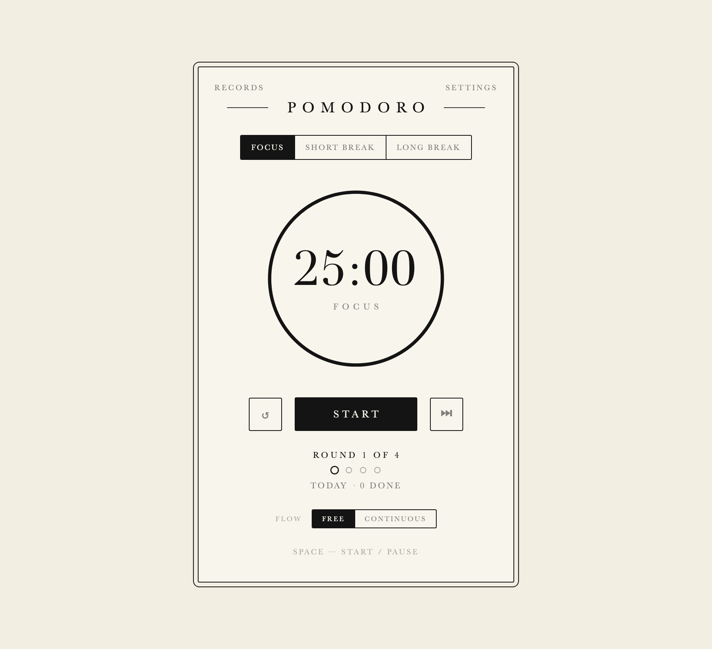

# Liam Pomodoro

[](CHANGELOG.md)
[](LICENSE)

A single-file Pomodoro timer with an ivory-and-black editorial look. No build step, no dependencies, no account — everything stays in your browser.



## Run

- **macOS** — double-click `launchers/macos.command`.
- **Windows** — double-click `launchers/windows.vbs`.
- **Any browser** — open `index.html`.

The launchers start a tiny local server at <http://127.0.0.1:8788/> and open it. Opening `index.html` directly works for everything except system notifications: browsers refuse notification permission on `file://` pages.

## Features

- Three session types — focus, short break and long break — with a thin ink progress ring.
- Two flows: **FREE** waits for you after each session; **CONTINUOUS** chains focus and breaks automatically.
- Start, pause, reset and skip; Space starts and pauses; the tab title shows the live countdown.
- Round tracking — a "ROUND x OF n" label and a row of dots, ending with "CYCLE COMPLETE — LONG BREAK".
- End-of-session chime (Web Audio, no audio files) and optional persistent system notifications, including from a background tab.
- **Records** — every completed focus session is logged with its start time and duration, plus an inline note; browse days, see daily totals, delete entries.
- **Settings** — focus, short-break and long-break lengths, rounds per cycle, chime and notifications; saved in `localStorage`.
- Today's count comes from the records using local dates, so midnight is correct in any time zone.
- Terminal control on macOS: `start`, `pause`, `skip`, `reset`, `status`.
- One HTML file: no frameworks, no network requests, no data leaves the browser.

## Launcher anywhere

There is no installer. Ask an AI agent to put a launcher where you want it:

> Create a Liam Pomodoro launcher at `<location>` using `<path-to-repo>/launchers/macos.command`.

Agent notes:

- **macOS** — write a small executable `.command` file at the requested location that `exec`s the repo's `launchers/macos.command`, and keep the executable bit. Do not copy `index.html`; the launcher resolves the app relative to the repository.
- **Windows** — create a shortcut at the requested location whose target is `wscript.exe "<repo>\launchers\windows.vbs"`.

## Terminal control (macOS)

```sh
./terminal/pomodoro           # toggle start / pause (default)
./terminal/pomodoro start     # start
./terminal/pomodoro pause     # pause
./terminal/pomodoro skip      # next session
./terminal/pomodoro reset     # reset the current session
./terminal/pomodoro status    # e.g. FOCUS 24:31 · RUNNING · TODAY 2
```

The timer tab must be open in Safari or Chrome, and the browser must allow JavaScript from Apple Events (Safari: Develop ▸ Allow JavaScript from Apple Events; Chrome: View ▸ Developer). The first run also asks macOS to let your terminal control the browser.

To install it as a command:

```sh
echo "alias pomodoro='$(pwd)/terminal/pomodoro'" >> ~/.zshrc
```

## Data

Settings and records are stored in `localStorage` (`pomodoro-settings`, `pomodoro-records`). Clearing site data erases them.

## Version

0.1.0 — see [CHANGELOG.md](CHANGELOG.md).

## Licence

[MIT](LICENSE)
